# Computer and Communication Networks : Application layer

Lecture 5

---
layout: default
---

# Content overview

- Application layer: overview
- DHCP
- DNS
- HTTP
- TLS
- A day in the life of a web request

---
layout: section
---

# Application layer: overview

---

# Some network apps


---
layout: three-slots
---

# Creating a network app

::left::
Write programs that:
- run on **different end systems**
- **communicate** over **network**
- e.g., web server software communicates with browser software

No need to write software for **network-core devices**:
- network-core devices **do not run user applications**
- keeping apps on **end systems** enables rapid development and deployment

::right::


---
layout: three-slots
---

# Client-server paradigm

::left::
**Server:** 
- always-on host
- permanent IP address
- often in data centers, for scaling

**Clients:**
- contact, communicate with server
- may be intermittently connected
- may have dynamic IP addresses
- do not communicate directly with each other
- e.g., HTTP, IMAP, FTP

::right::


---
layout: three-slots
---

# Peer-peer architecture

::left::
- no always-on server
- arbitrary end systems directly communicate
- peers request service from other peers, provide service in return to other peers
  - self scalability – new peers bring new service capacity, as well as new service demands
- peers are intermittently connected and change IP addresses
- complex management
- e.g., P2P file sharing [BitTorrent], Ethereum ...

::right::


---

# Processes communicating

**Process:** program running within a host

- Within the **same host** -> two processes communicate using **inter-process communication (IPC)**  
  *(defined by the operating system)*.
- In **different hosts** -> processes communicate by **exchanging messages** over the network.

**Clients and Servers**
- **Client process:** initiates communication.
- **Server process:** waits to be contacted.

*Note: applications with P2P architectures have client processes & server processes.*

---
layout: three-slots
---

# Recap: sockets and addressing (from L4)

::left::
<div class="text-sm">

- **Socket** -> the door between a process and the transport layer (OS)
- IP address identifies a host interface, not a process
- Socket = **IP address + protocol + port**
  - server -> well-known port (80, 443, 53)
  - client -> ephemeral port from the OS

<v-click>

Browser opens https://fiit.stuba.sk:

`192.168.1.10:51234/TCP`<br>
`-> 147.175.1.61:443/TCP`

***How does the browser know 147.175.1.61?***
</v-click>

</div>

::right::


---

# An application-layer protocol defines:

- **Types of messages exchanged:** e.g., request, response...
- **Message syntax:** what fields in messages & how fields are delineated
- **Message semantics:** meaning of information in fields
- **Rules** for when and how processes send & respond to messages.
- **Open protocols:**
  - defined in RFCs, everyone has access to protocol definition
  - allows for interoperability
  - e.g., HTTP, SMTP
- **Proprietary protocols:**
  - e.g., Zoom

---

# What transport service does an app need?
<v-click>

**Reliable data transfer:**
- some apps (e.g., file transfer, web) need every byte delivered; others (e.g., real-time voice and video calls) can tolerate some loss.
</v-click>
<v-click>

**Timing:**
- some apps (e.g., Internet telephony, interactive games) require low delay to be "effective".
</v-click>
<v-click>

**Throughput:**
- some apps (e.g., live video calls) need a minimum throughput; others (elastic apps, e.g., file transfer, web) use whatever bandwidth is available.
</v-click>
<v-click>

**Security:**
- confidentiality (encryption), integrity (tamper detection), authentication
</v-click>

---

# Which transport do apps use?

<div class="compact text-sm">

| Application | App-layer protocol | Transport | Port |
|---|---|---|---|
| Network configuration | DHCP | UDP | 67/68 |
| Name lookup | DNS | UDP (TCP for large replies) | 53 |
| Web | HTTP/1.1, HTTP/2 | TCP | 80/443 |
| Web (modern) | HTTP/3 | QUIC over UDP | 443 |
| E-mail | SMTP / IMAP | TCP | 25, 587 / 993 |
| Voice and video calls | RTP (WebRTC) | UDP | dynamic |
| Remote login | SSH | TCP | 22 |

</div>

<div class="text-sm pt-2">

- TCP -> reliability only, no timing, throughput, or security guarantees; UDP -> only ports and a checksum
- Security is added on top by **TLS** (later today)

</div>

<style>
.compact td, .compact th { padding-top: 0.2rem; padding-bottom: 0.2rem; }
</style>

---

# Before any app can run…

To open https://fiit.stuba.sk, your laptop needs:

<v-clicks>

1. its own IP address, subnet mask, default gateway, and DNS server -> **DHCP**
2. the IP address of the server -> **DNS**
3. to fetch the page -> **HTTP**
4. to do it securely -> **TLS**

</v-clicks>

---
layout: section
---

# Dynamic Host Configuration Protocol (DHCP)

---

# Joining a New Network

When connecting to a new Ethernet network, a host needs to learn:
- **Subnet mask:** What range of addresses are local?
- **Default gateway:**  Where is the router (to reach non-local networks)?  
- **DNS server:** Where is the recursive resolver?
- **IP address:** What address can I use on this network?

*Note: The host already has a **MAC address** (built into hardware).*

Manual vs. Automatic Configuration:
- We **could** configure all this information manually.
  - But we'd have to **reconfigure every time** we join a different network. 
  - Therefore, we want an **automatic protocol** to obtain these parameters.

*Note: Manual configuration is fine for routers, which rarely move.*

---

# DHCP Handshake

<div class="flex justify-center">

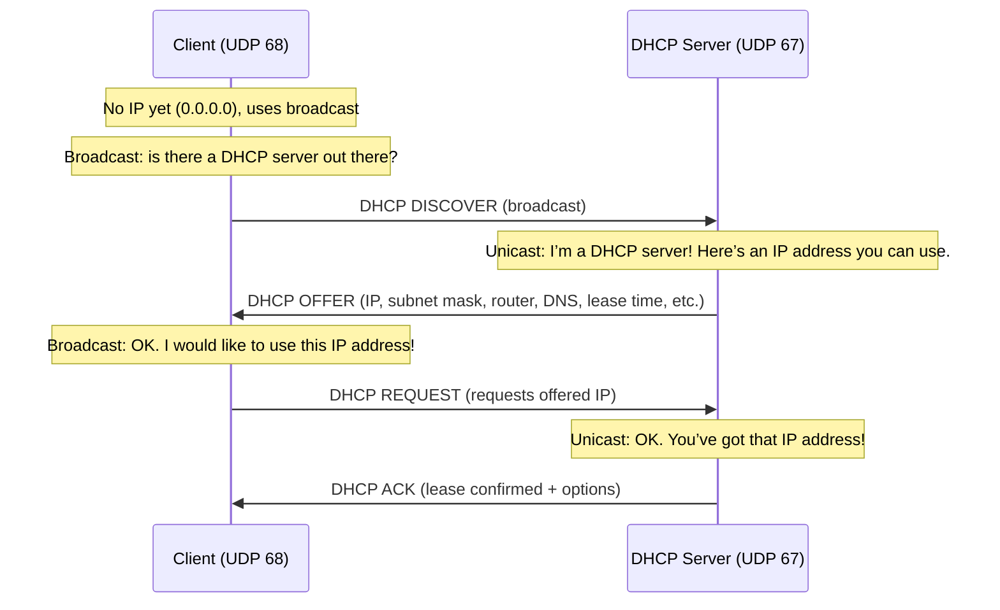
</div>

---

# DHCP Servers

DHCP servers offer configurations to new hosts.
- Listen on UDP port 67 for requests.

DHCP servers are configured with required information:
- Subnet mask, gateway router IP address, DNS resolver IP address.
- A pool of usable IP addresses.
- DHCP is extensible to provide other information.

Where are the DHCP servers?
- In a small network: Your home router.
- In a larger network: Could be a separate machine.
- Must be in same local network as the clients.
  - In larger networks, router could relay requests to a remote DHCP server

---

# Leasing IP Addresses

DHCP servers temporarily lease IP addresses to hosts.
- Host can only use that IP address for a limited time (hours or days).
- Host must renew the lease to keep using the address.
- Servers don't offer the same address to other clients if leased.
  - Avoids two hosts getting the same address.

---

# DHCP Implementation

DHCP is a Layer 7 protocol, running on top of UDP/IP.


---
layout: section
---

# Domain Name System (DNS)

---

# DNS: overview

Translates **human-readable names** into **IP addresses**:

<v-clicks>

- you type fiit.stuba.sk -> your computer performs a **DNS lookup** -> 147.175.1.61 -> packets go to that IP
- a **distributed database** of resource records, stored on many **name servers** organized in a hierarchy
- e.g., the name servers of the fiit.stuba.sk zone store the mapping fiit.stuba.sk -> 147.175.1.61
- other services:
  - **host aliasing** -> one canonical name, several aliases (www.stuba.sk is an alias of neptun.cvt.stuba.sk)
  - **mail server aliasing** -> which server receives mail for a domain (mail for @stuba.sk goes to smtp.cvt.stuba.sk)
  - **load distribution** -> one name, many IP addresses (amazon.com -> 98.87.170.74, 98.87.170.71, 98.82.161.185)

</v-clicks>

---

# DNS: a distributed, hierarchical database


<div class="text-sm">

- **Root servers** -> know the TLD servers; 13 names (a–m.root-servers.net), ~1 900 instances worldwide via anycast
- **TLD servers** -> generic (.com, .org, .net, .app, …) and country-code (.sk, .uk, .jp); e.g., Verisign runs .com/.net, SK-NIC runs .sk
- **Authoritative servers** -> an organization's own name servers with the records for its names, run by the organization or a provider

</div>

---

# Zones and delegation

- **Domain** -> a subtree of names (fiit.stuba.sk is part of the stuba.sk domain)
- **Zone** -> a part of the tree administered as one unit; it ends where a subdomain is delegated
- A parent zone **delegates** a subdomain by publishing its **NS records**; if those servers lie inside the subdomain, also their addresses (**glue**)

The stuba.sk servers do not know the address of fiit.stuba.sk, they only point to its name servers:

```text
$ dig +norec fiit.stuba.sk @ns.cvt.stuba.sk
;; AUTHORITY SECTION:
fiit.stuba.sk.      86400  IN  NS  ns.fiit.stuba.sk.
fiit.stuba.sk.      86400  IN  NS  ns2.fiit.stuba.sk.
;; ADDITIONAL SECTION:
ns.fiit.stuba.sk.   86400  IN  A   147.175.159.11
ns2.fiit.stuba.sk.  86400  IN  A   147.175.159.1
```

---

# DNS name resolution: iterative query

- The queried server answers only from its own data: either the **final answer** or a **referral** ("I don't know, ask these servers": NS names + their addresses)
- The asking side performs the next step itself

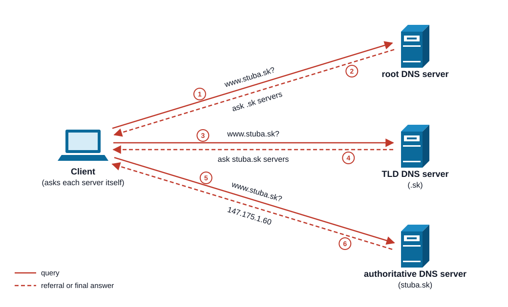

---

# Recursive resolver (local DNS server)

<div class="text-sm">

A host does not walk the hierarchy itself:

- **Stub resolver** -> a small part of the OS on the host (called via `getaddrinfo`); it only sends a recursive query and waits for the final answer
- **Recursive resolver** -> does the actual work for many clients:
  - answers from its **cache** of recent results (possibly out of date)
  - otherwise resolves the name itself by querying root -> TLD -> authoritative
  - its address is learned via **DHCP**; run by the ISP, university or company, or public (8.8.8.8, 1.1.1.1)
  - not part of the hierarchy: it is authoritative for no zone

Find yours:
- Linux: `resolvectl status`
- macOS: `scutil --dns`
- Windows: `ipconfig /all`

</div>

---

# DNS name resolution: recursive query

- **Recursive query** (RD=1) -> "give me the final answer"; the resolver then performs steps 2–7 iteratively
- Each query is recursive or iterative, not the whole lookup: host -> resolver recursive, resolver -> hierarchy iterative

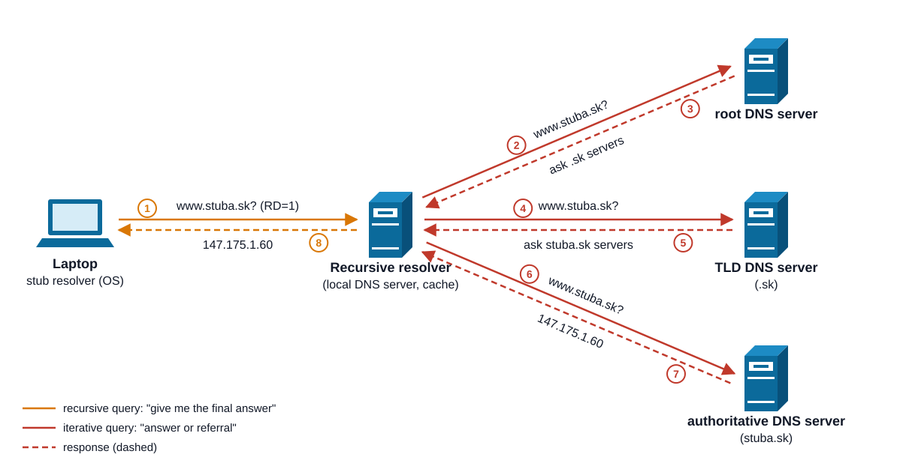

---

# Caching DNS information

<v-clicks>

- Once a resolver learns a record, it **caches** it and answers later queries immediately
- Each record has a **TTL** (seconds), set by the zone owner; after it expires, the record is dropped
- NS and glue of TLD servers are almost always cached, so root servers are rarely contacted
- **Negative answers** (name does not exist) are cached too
- Cached entries may be out of date: after an IP change, the old address is used until TTLs expire -> best-effort translation

</v-clicks>

---

# DNS records

DNS stores **resource records**: `name  TTL  class  type  value`

<div class="compact text-sm">

| Type | Name | Value | Example |
|---|---|---|---|
| **A** | hostname | IPv4 address | fiit.stuba.sk -> 147.175.1.61 |
| **AAAA** | hostname | IPv6 address | google.com -> 2a00:1450:… (next lecture) |
| **CNAME** | alias | canonical name | www.stuba.sk -> neptun.cvt.stuba.sk |
| **NS** | domain | authoritative name server | fiit.stuba.sk -> ns.fiit.stuba.sk |
| **MX** | domain | mail server (+ priority) | stuba.sk -> 10 smtp.cvt.stuba.sk |

</div>

Others: **PTR** (reverse, IP -> name), **TXT** (free text, e.g. mail policies), **SOA** (zone parameters)

```text
www.stuba.sk.   4892  IN  CNAME  neptun.cvt.stuba.sk.
```

<style>
.compact td, .compact th { padding-top: 0.2rem; padding-bottom: 0.2rem; }
</style>

---

# DNS message

Query and reply use the same format: a **header** and four sections

```text
$ dig +norec www.fiit.stuba.sk @ns.fiit.stuba.sk
;; ->>HEADER<<- opcode: QUERY, status: NOERROR, id: 61911
;; flags: qr aa ra; QUERY: 1, ANSWER: 1, AUTHORITY: 2, ADDITIONAL: 2
;; QUESTION SECTION:
;www.fiit.stuba.sk.        IN  A
;; ANSWER SECTION:
www.fiit.stuba.sk.  3600  IN  A   147.175.1.61
;; AUTHORITY SECTION:
fiit.stuba.sk.      3600  IN  NS  ns2.fiit.stuba.sk.
fiit.stuba.sk.      3600  IN  NS  ns.fiit.stuba.sk.
;; ADDITIONAL SECTION:
ns.fiit.stuba.sk.   3600  IN  A   147.175.159.11
ns2.fiit.stuba.sk.  3600  IN  A   147.175.159.1
```

<div class="text-sm">

- **Question** -> name and type being asked
- **Answer** -> records answering the question
- **Authority** -> NS records of the zone's servers (the referral), or SOA in a negative answer
- **Additional** -> extra helpful records, e.g. addresses of those servers (glue)

</div>

---

# DNS header

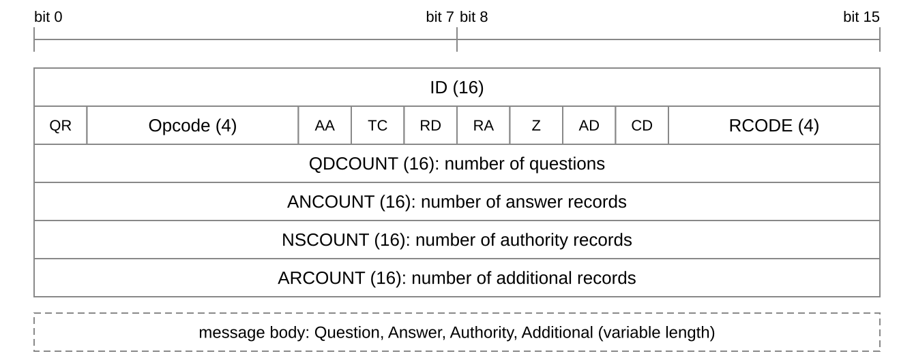

---

# DNS security

<v-clicks>

- Classic DNS: UDP, no encryption, no authentication
- **Spoofing / cache poisoning** -> an attacker forges a reply (guesses ID + port) and the resolver caches a fake address
- **DNSSEC** -> signed records: authenticity, not privacy
- **DoT** (TLS, port 853) / **DoH** (HTTPS, port 443) -> encrypt the client ↔ resolver path
- Why this matters for the web: see **TLS**

</v-clicks>

---
layout: section
---

# Hypertext Transfer Protocol (HTTP)

---

# Web and HTTP

- A web page consists of a base **HTML file** and many referenced **objects** (CSS, JavaScript, images, fonts, video, …)
- Objects can be stored on different web servers (e.g., a CDN)
- Each object is addressed by a **URL** (Uniform Resource Locator) and fetched by **its own HTTP request**

<div class="text-sm pt-2">

`https://www.fiit.stuba.sk/harmonogram-studia.html?page_id=4941#harmonogram-akademickeho-roka-kalendar`

</div>

<div class="compact text-sm">

| Part | Value | Meaning |
|---|---|---|
| **Scheme** | `https` | protocol; also determines the default port |
| **Host** | `www.fiit.stuba.sk` | server name, resolved by DNS |
| **Port** | *(implicit)* | default 443 for https, 80 for http; explicit as `host:8080` |
| **Path** | `/harmonogram-studia.html` | resource on the server; defaults to `/` |
| **Query** | `page_id=4941` | optional parameters, after `?` |
| **Fragment** | `harmonogram-akademickeho-roka-kalendar` | position within the page, after `#`; never sent to the server |

</div>

<style>
.compact td, .compact th { padding-top: 0.15rem; padding-bottom: 0.15rem; }
</style>

---

# HTTP overview

- The web's application-layer protocol, **client/server** model:
  - client -> browser: requests, receives and displays web objects
  - server -> web server (e.g., nginx, Apache): sends objects in response to requests
- Runs over a transport protocol:
  - HTTP/1.1, HTTP/2 -> **TCP**: handshake first, then HTTP messages over the bytestream
  - HTTP/3 -> **QUIC** over UDP
- Well-known port 80; **HTTPS** = HTTP over TLS, port 443
- **Stateless** -> the server keeps no information about past requests; state is added by cookies
- After the response, the TCP connection is closed (HTTP/1.0) or reused for further requests (HTTP/1.1+)

---

# HTTP message anatomy


<div class="text-sm">

Request and response have the same structure:
- **Start line** -> request line (method, path, version) or status line (version, status code, reason)
- **Headers** -> `Name: value` lines, e.g., `Host`, `Content-Type`, `Content-Length`
- **Empty line** -> marks the end of the headers
- **Body** -> optional data, e.g., a submitted form or the returned HTML page

</div>

---

# HTTP request line

The first line of every request; human-readable plaintext in HTTP/1.x (HTTP/2 and HTTP/3 are binary)

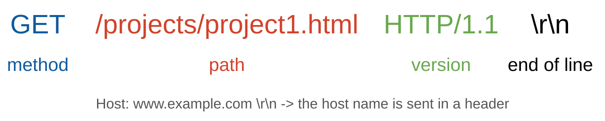

- <span class="text-blue-800">**Method**</span> -> what we want to do with the resource
- <span class="text-red-800">**Path**</span> -> which resource on the server (intuition: a file path on a remote server); the host name is sent in the `Host` header
- <span class="text-green-800">**Version**</span> -> which HTTP version we use

---

# HTTP methods

- **GET** -> retrieve a resource
- **POST** -> send data to the server (e.g., a submitted form, a JSON API call)
- **PUT** -> create or replace the resource at the given URL
- **DELETE**, **PATCH** -> delete or partially modify a resource
- **HEAD** -> like GET, but returns only the headers (does it exist, how big, when changed)
- **OPTIONS**, **TRACE**, **CONNECT** -> diagnostics and proxies (CONNECT opens a tunnel, e.g., HTTPS through a proxy)

**Safe** methods (GET, HEAD) do not change anything on the server -> they can be cached and repeated

---

# HTTP status line

The first line of every response

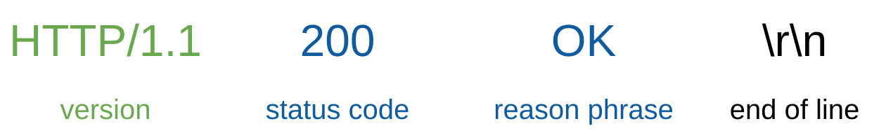

- <span class="text-green-800">**Version**</span> -> which HTTP version the server uses
- <span class="text-blue-800">**Status code**</span> -> a number saying what happened with the request; the client acts on it
- <span class="text-blue-800">**Reason phrase**</span> -> human-readable text for the code; ignored by the client

---

# HTTP status codes

The first digit gives the class of the result:

<div class="compact text-sm">

| Class | Meaning | Examples |
|---|---|---|
| **1xx** | informational | 101 Switching Protocols |
| **2xx** | success | **200 OK** |
| **3xx** | redirection, new address in the `Location` header | **301 Moved Permanently**, 302 Found (temporary), **304 Not Modified** |
| **4xx** | client error | 400 Bad Request, 403 Forbidden, **404 Not Found** |
| **5xx** | server error | **500 Internal Server Error**, 503 Service Unavailable |

</div>

<style>
.compact td, .compact th { padding-top: 0.2rem; padding-bottom: 0.2rem; }
</style>

---
layout: three-slots
---

# Cookies: state on top of stateless HTTP

::left::
<div class="text-sm">

- HTTP is stateless -> the server needs a way to recognize the same user across requests
- First response -> `Set-Cookie: session=ab12`
- The browser stores the cookie and sends `Cookie: session=ab12` with every further request to that site
- The state itself lives on the server (database), the cookie carries only an ID
- Used for -> logins, shopping carts, preferences, but also **tracking** across sites (third-party cookies)

</div>

::right::
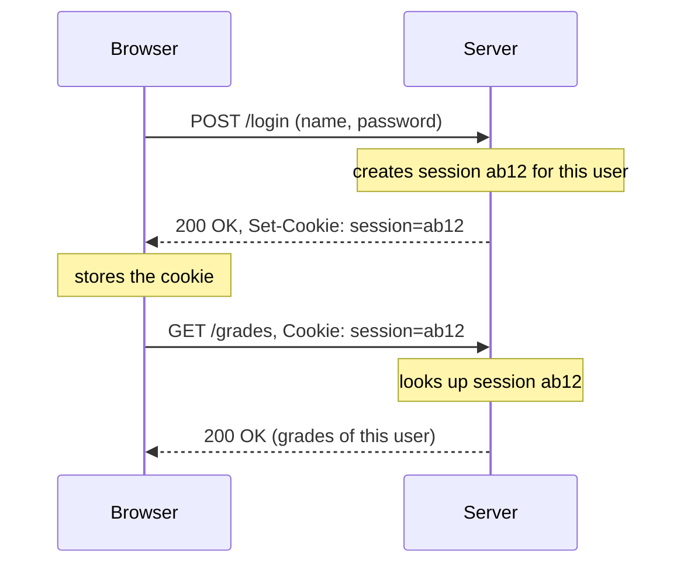

---
layout: three-slots
---

# Web caching and conditional GET

::left::
<div class="text-sm">

- A **web cache** keeps copies of objects: browser cache, proxy, CDN -> less data, lower latency, less load on the server
- `Cache-Control: max-age=3600` -> how long the copy is fresh (like TTL in DNS)
- After that, the cache asks with a **conditional GET**: `If-None-Match` (ETag) or `If-Modified-Since`
- Not changed -> **304 Not Modified**, no body; changed -> 200 OK with the new object

</div>

::right::
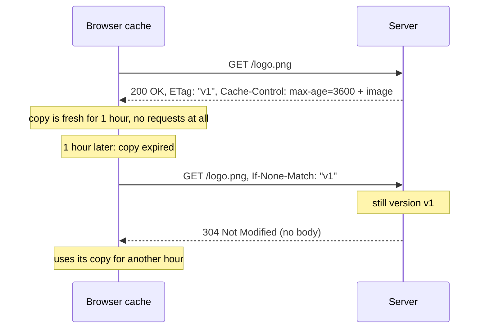

---
layout: three-slots
---

# HTTP/1.0 vs HTTP/1.1: persistent connections

<v-click>

<div class="text-sm">

A page has many objects: does each one need its own TCP connection?

</div>

</v-click>

::left::
<v-click>

<div class="text-sm">

**HTTP/1.0** -> new TCP connection per object, **2 RTT per object**

</div>

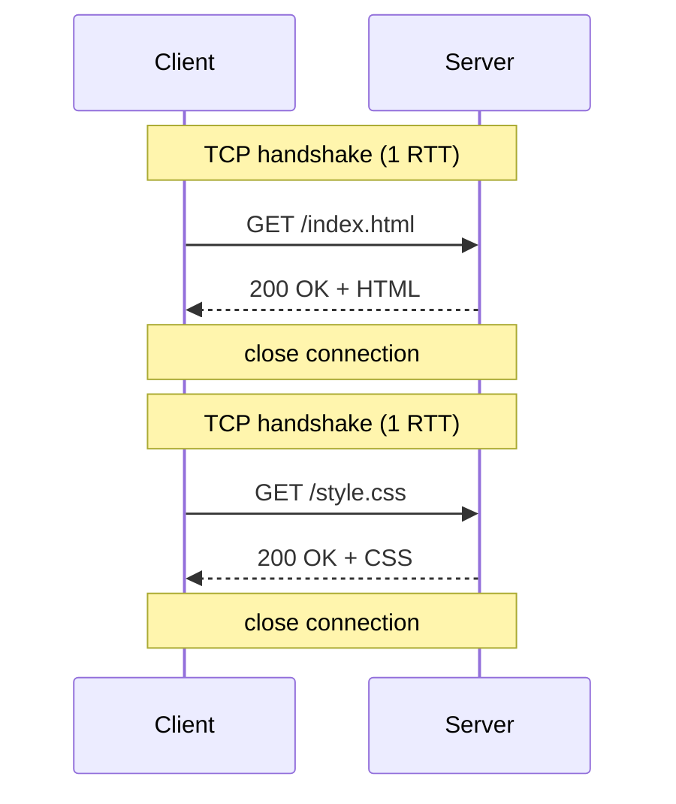

</v-click>

::right::
<v-click>

<div class="text-sm">

**HTTP/1.1** -> one connection reused, **~1 RTT per object**

</div>

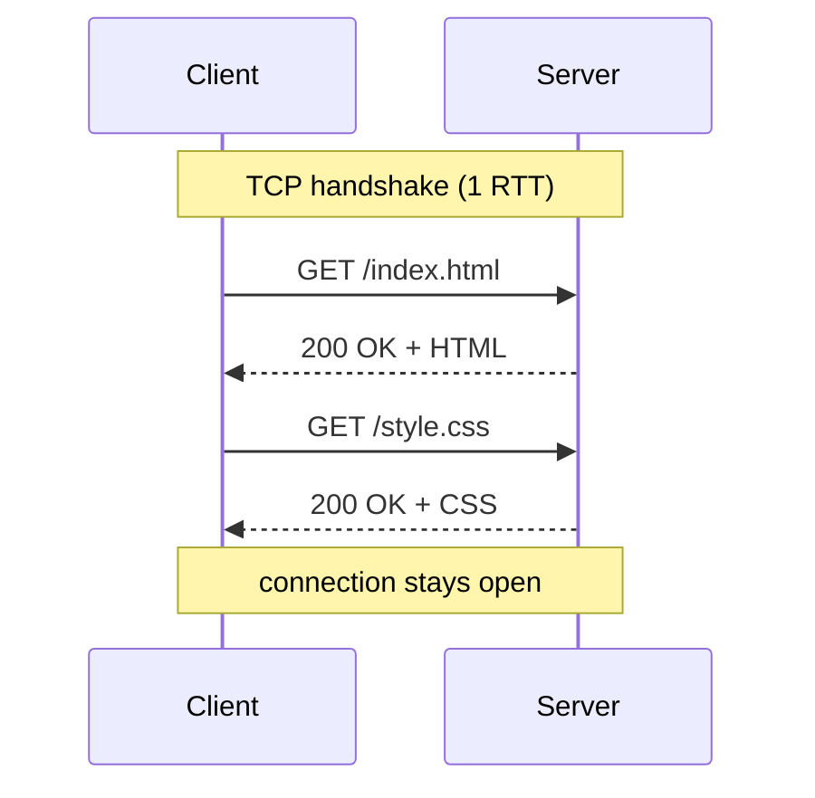

</v-click>

---
layout: three-slots
---

# HTTP/2: multiplexing

<v-click>

<div class="text-sm">

One slow response on a persistent connection: what happens to the others?

</div>

</v-click>

<v-click at="4">

<div class="absolute bottom-2 left-14 right-14 text-sm">

Still one TCP bytestream: one lost segment stalls **all** streams (TCP head-of-line blocking) -> **HTTP/3 over QUIC** (after TLS)

</div>

</v-click>

::left::
<v-click>

<div class="text-sm">

**HTTP/1.1** -> one request at a time, a slow response blocks the rest (**head-of-line blocking**)

</div>

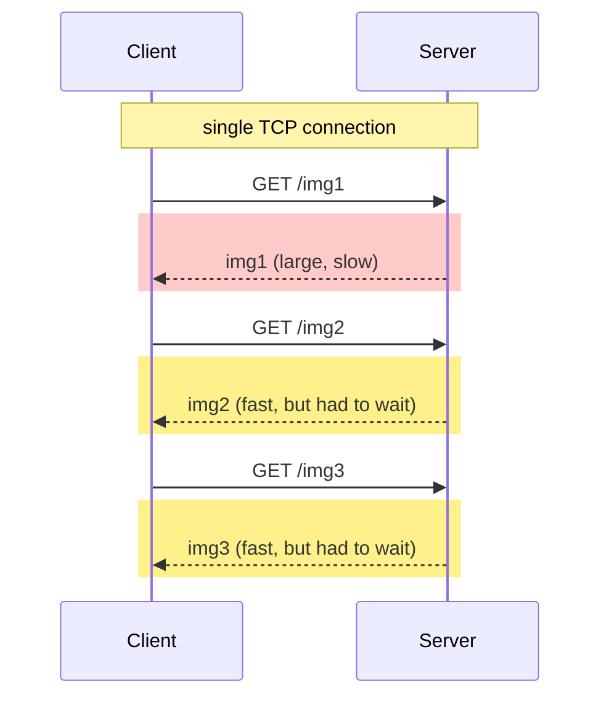

</v-click>

::right::
<v-click>

<div class="text-sm">

**HTTP/2** -> many streams in a single TCP connection; objects split into **frames**, frames of different streams interleaved

</div>

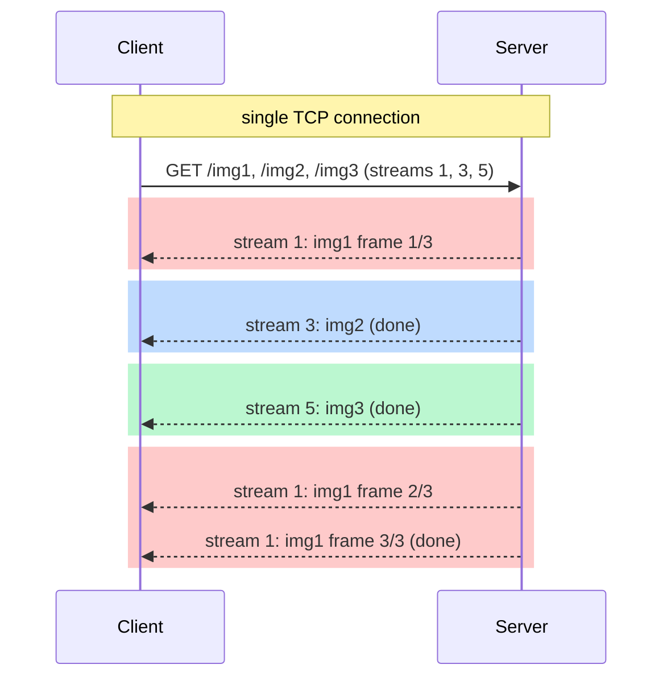

</v-click>

---
layout: three-slots
---

# HTTP/2 frame: binary, not text

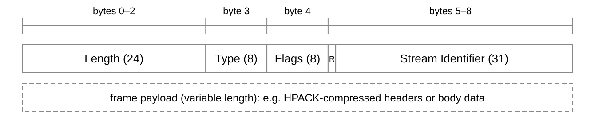

<div class="text-sm text-center">

Same meaning (method, path, headers), different encoding on the wire

</div>

::left::
<div class="text-sm">

**HTTP/1.1** -> text; end of headers = empty line (41 bytes)

</div>

```text
GET / HTTP/1.1\r\n
Host: www.example.com\r\n
\r\n
```

::right::
<div class="text-sm">

**HTTP/2** -> binary HEADERS frame; length in the header, headers compressed by HPACK (9 + 17 bytes)

</div>

```text
00 00 11      Length = 17
01            Type = HEADERS
05            Flags = END_STREAM | END_HEADERS
00 00 00 01   Stream ID = 1
82            :method GET
87            :scheme https
84            :path /
41 8c f1 e3 c2 e5 f2 3a 6b a0 ab 90 f4 ff
              :authority www.example.com
```

---
layout: section
---

# Transport Layer Security (TLS)

---

# Plain TCP is not secure

<div class="text-sm">

- **Eavesdropping and tampering** -> anyone on the path (Wi-Fi, router, ISP) can read or modify the TCP payload
- **Impersonation** -> a spoofed DNS reply sends you to the attacker's IP, and you talk to the wrong server

</div>


<v-click>

<div class="text-sm">

Encryption alone fixes the first problem; the second needs **server authentication** (certificates)

</div>

</v-click>

---
layout: three-slots
---

# Secure bytestreams

::left::
<div class="text-sm">

- TLS sits between TCP and the application
- Uses the TCP bytestream (L4), provides a **secure bytestream** to the application (L7)
- Same abstraction, but the data are **encrypted and integrity-protected**
- **HTTPS** = HTTP over TLS over TCP, port 443; plain HTTP uses port 80
- Not only for the web: IMAPS (993), SMTP with STARTTLS, DNS over TLS (853)
- The 5-layer model has no slot for it -> "layer 4.5"; implemented as a **library in the application** (OpenSSL, BoringSSL), not in the OS

</div>

::right::


---

# TLS: what it provides

The three security services from the beginning of the lecture:

<v-clicks>

- **Confidentiality** -> data are encrypted, an eavesdropper sees only random bytes
- **Integrity** -> every record carries a MAC (TLS 1.3: AEAD ciphers); any change is detected
- **Authentication** -> the server proves its identity with a **certificate**; the client usually stays anonymous at the TLS level (it logs in later via HTTP)

</v-clicks>

<v-click>

All of this is set up by the **TLS handshake**, which runs over the TCP connection, after the TCP handshake.

</v-click>

---
layout: three-slots
---

# TLS 1.3 handshake

::left::
<div class="text-sm">

<v-clicks>

1. **ClientHello** -> random, supported cipher suites, key share, server name (**SNI**), application protocol (**ALPN**, e.g. h2)
2. **ServerHello** -> chosen cipher suite and its key share; both sides now compute the same secret (**ECDHE**), everything after this is encrypted
3. **Certificate + CertificateVerify** -> sent by the server right after ServerHello (already encrypted): its certificate chain and a signature of the handshake with its private key, proof of identity
4. **Finished** (both sides) -> MAC over the whole handshake: detects any tampering
5. The client sends its Finished together with the first **GET**: TLS costs **1 RTT** after the TCP handshake

</v-clicks>

</div>

::right::
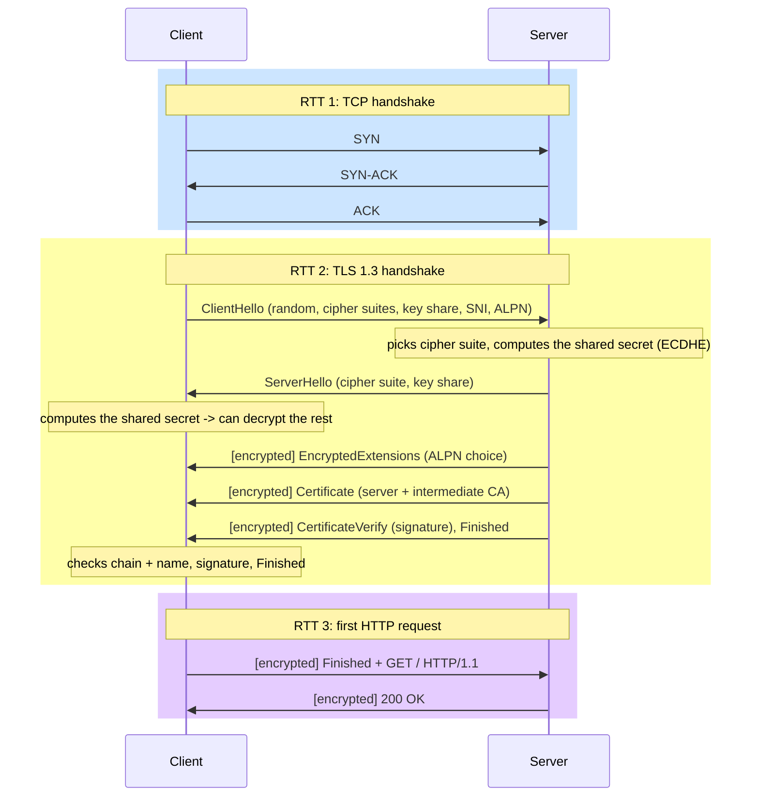

---
layout: three-slots
---

# Key exchange: ECDHE

How can client and server agree on a secret key if an eavesdropper sees every byte?

::left::
<div class="text-sm">

<v-clicks>

- **Diffie-Hellman (DH)** -> each side picks a random **private** value and sends only a **public** value computed from it: the **key share**
- From its own private value and the other side's public value, each side computes the **same shared secret**
- An eavesdropper sees both public values, but cannot compute the secret: it would have to invert a one-way function
- The secret itself is never sent; both sides derive the symmetric session keys (e.g. AES) from it
- **EC** = elliptic curves: same idea, shorter keys, faster math (in practice X25519, a 32-byte key share)
- **E** = ephemeral: a new key pair for every connection -> **forward secrecy**: a stolen server key does not decrypt old recorded traffic
- DH alone does not say **who** is on the other side; that is the job of the certificate

</v-clicks>

</div>

::right::
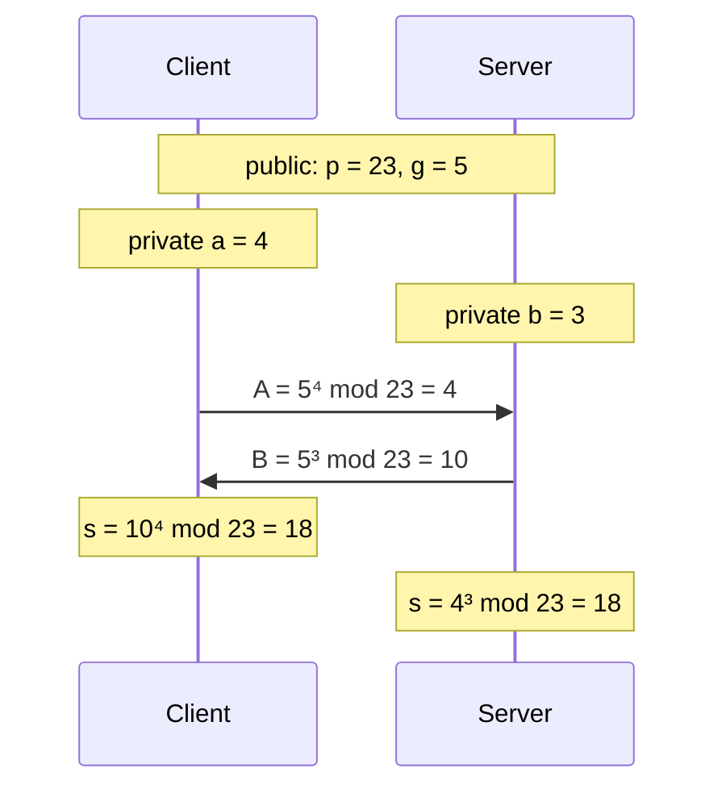

<div class="text-xs text-center">

Toy example with small numbers. The eavesdropper sees 23, 5, 4 and 10, but needs a or b to get 18.

</div>

---
layout: three-slots
---

# Certificates and certificate authorities

::left::
<div class="text-sm">

- **Certificate** -> binds a domain name to a public key, signed by a **certificate authority** (CA)
- The browser checks:
  - the **chain** of signatures up to a root CA it already trusts (trust store in the OS or browser)
  - the **name** in the certificate matches the URL
  - the certificate is **valid** (dates, not revoked)
- **CertificateVerify** -> the server proves it owns the matching private key
- A spoofed DNS reply does not help the attacker: no valid certificate and key for that name -> browser warning

</div>

::right::
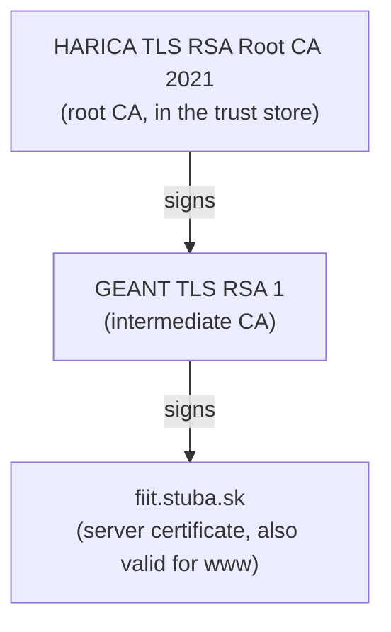

<div class="text-xs text-center">

Real chain of www.fiit.stuba.sk

</div>

---
layout: three-slots
---

# TLS 1.2 vs TLS 1.3

<v-click>

<div class="text-sm">

Why does TLS 1.3 need one round trip less? (both after the TCP handshake)

</div>

</v-click>

::left::
<v-click>

<div class="text-sm">

**TLS 1.2** -> key exchange only in the 2nd round trip, certificate in plaintext: **2 RTT**

</div>

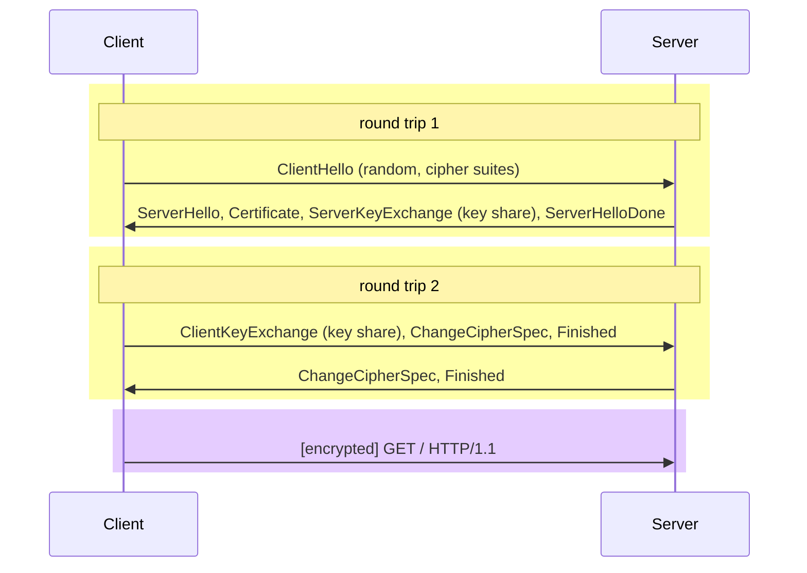

</v-click>

::right::
<v-click>

<div class="text-sm">

**TLS 1.3** -> the client sends its key share already in ClientHello: **1 RTT**

</div>

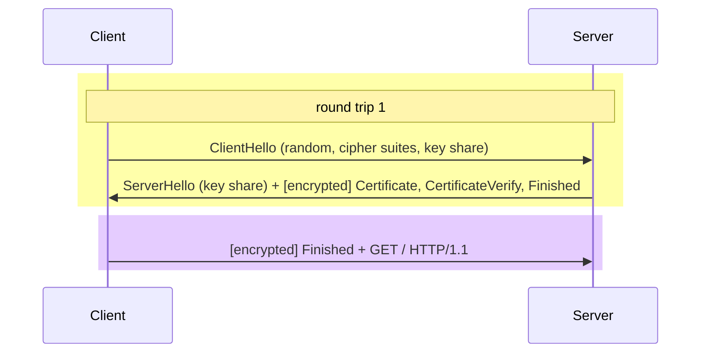

</v-click>

---

# TLS costs and limits

<div class="text-sm">

**Latency before the first HTTP request:**

| | Round trips |
|---|---|
| TCP + TLS 1.2 | 1 + 2 = **3 RTT** |
| TCP + TLS 1.3 | 1 + 1 = **2 RTT** (0-RTT when resuming a session) |
| QUIC (HTTP/3) | **1 RTT** for transport and TLS together |

**What TLS does not hide:**
- IP addresses and ports (IP and TCP headers stay readable)
- the server name in ClientHello (SNI), unless Encrypted Client Hello is used
- DNS queries, unless DoH or DoT is used
- sizes and timing of messages

**What the lock icon means:** an encrypted connection to the server that owns this domain name, not "a trustworthy website"

</div>

---

# HTTP/3 over QUIC

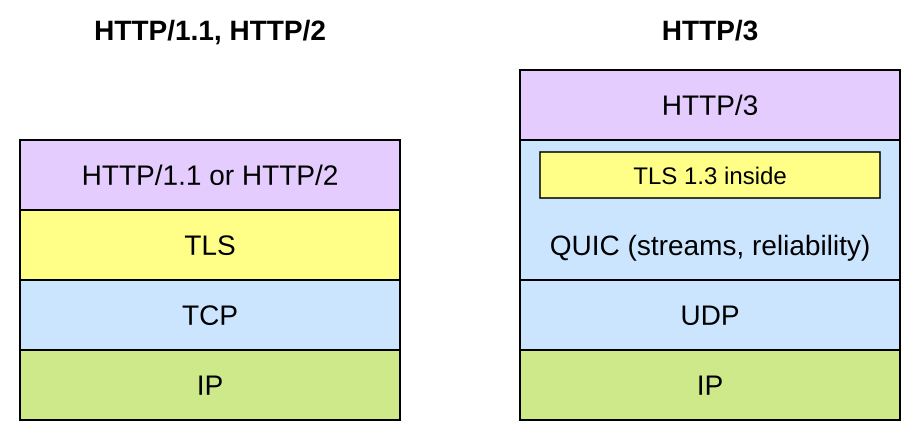

<div class="text-sm">

- **Why** -> TCP head-of-line blocking (HTTP/2) and the extra RTTs of TCP + TLS
- **QUIC** -> a transport over UDP, implemented in user space (browser, server), not in the OS
  - streams in the transport -> a lost packet delays only its own stream
  - TLS 1.3 built in -> connection and encryption in **1 RTT**
  - connection ID instead of IP + port -> the connection survives a change of network (Wi-Fi -> mobile)
- **HTTP/3** = the same HTTP semantics (methods, status codes, headers) over QUIC

</div>

---
layout: three-slots
---

# QUIC vs. TCP + TLS

<v-click>

<div class="text-sm">

What does QUIC change in practice? Two things: connection setup and packet loss.

</div>

</v-click>

::left::
<v-click>

<div class="text-sm">

**Setup** -> transport and TLS in one handshake: **1 RTT** (TCP + TLS 1.3: 2 RTT)

</div>

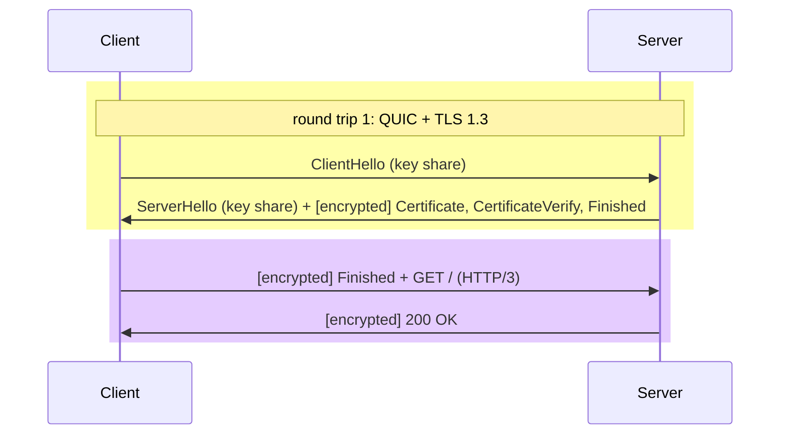

<div class="text-xs text-center">

Resumed connection: **0-RTT**, the GET goes already with the ClientHello

</div>

</v-click>

::right::
<v-click>

<div class="text-sm">

**Loss** -> streams are independent in the transport: a lost packet delays **only its own stream**

</div>

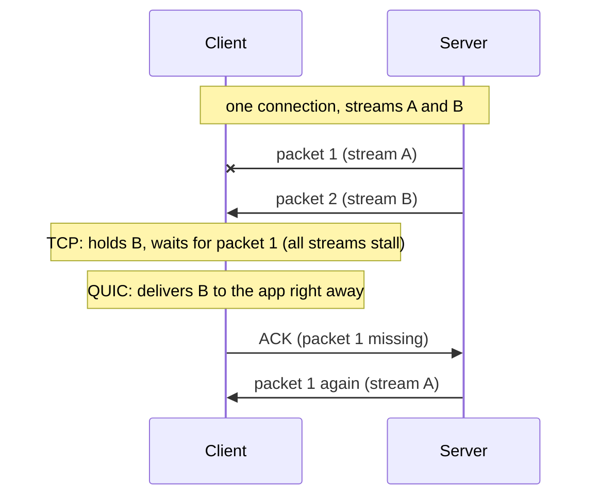

</v-click>

---
layout: section
---

# A day in the life of a web request

---

# A day in the life: scenario

A student arrives home and connects their laptop to the home network. They request the faculty web page www.fiit.stuba.sk to check the schedule for the next day.

*Note: We'll assume we don't need to turn on the Internet from scratch. Routers' forwarding tables are already populated.*

---

# A day in the life: DHCP

We connect to the Ethernet network and make a DHCP request.

The router responds with: IP address, subnet mask, default gateway, DNS server.

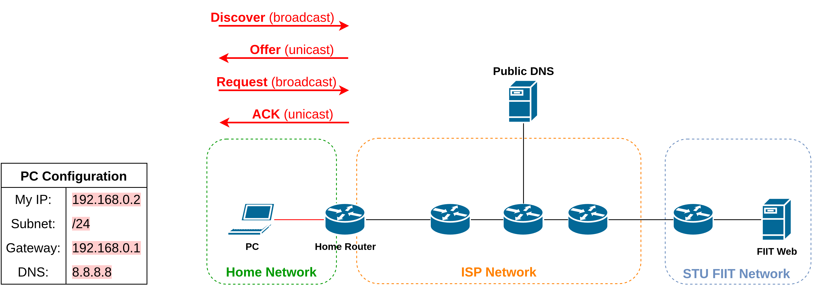

---

# A day in the life: ARP

We're about to send some non-local packets, e.g. DNS request to 8.8.8.8.

We need the MAC address of the default gateway (192.168.0.1). We can use ARP!

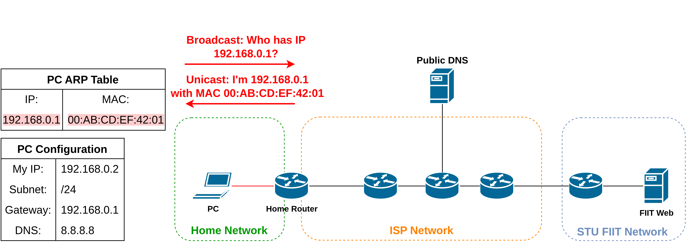

---

# A day in the life: DNS packet

We can now build a DNS request packet, to find the IP address of www.fiit.stuba.sk.

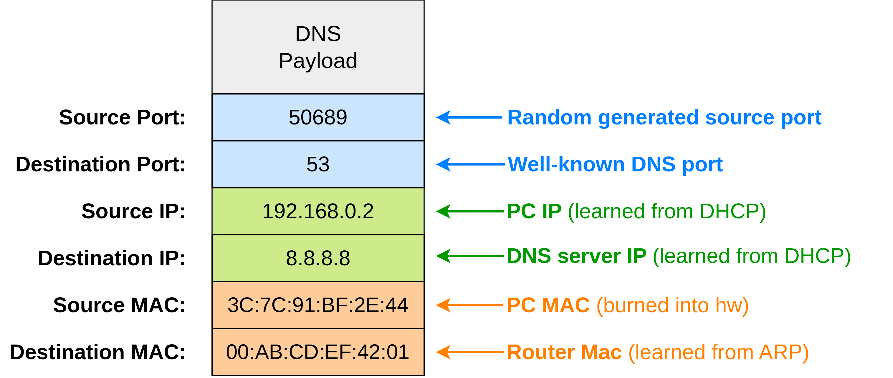

---

# A day in the life: DNS lookup

*Note: The home router's NAT rewrites the source address and port to its public IP. The PC never sees this (recall NAT from the network layer lecture).*

*Note: The recursive resolver might have to ask other name servers.*

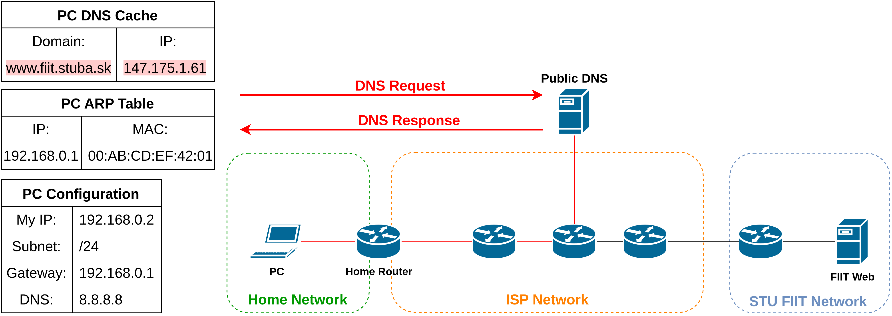

---

# A day in the life: TCP and TLS handshake

Now that we know the IP address of www.fiit.stuba.sk, we can send packets there.

A 3-way handshake establishes the TCP connection to port 443 (HTTPS). Then the TLS handshake sets up encryption: one more round trip.

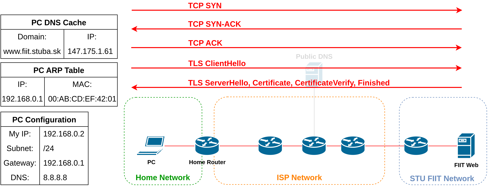

---

# A day in the life: HTTP request

We can now build an HTTP request. TLS encrypts it into a TLS record, sent to port 443.

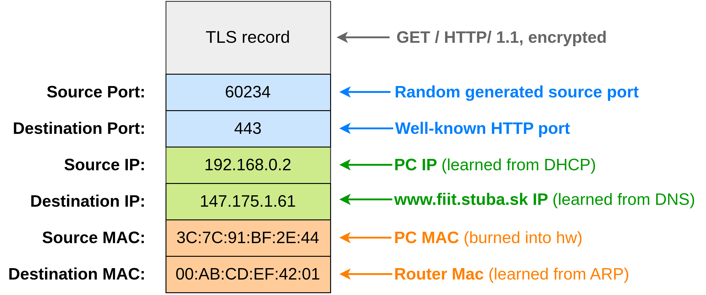

---

# A day in the life: HTTP response

The server sends an HTTP response with an HTML page.

The page triggers further HTTP requests (images, CSS), sent one after another over the same persistent connection.

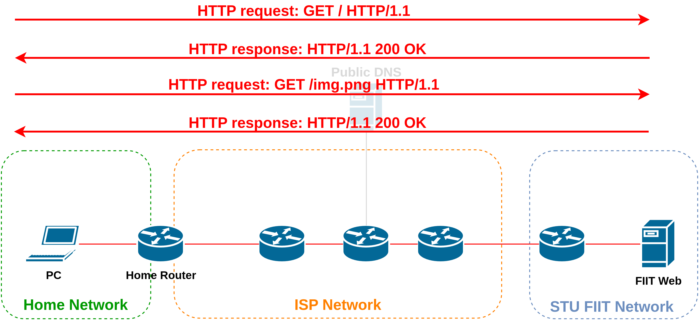

*Note: TCP provides a bytestream abstraction, so each HTTP request/response could be multiple packets.*

---

# A day in the life: messages in the bytestream

How does the receiver know where one HTTP message ends in the bytestream?

- The header section ends with an empty line (CRLF CRLF)
- The Content-Length header says how many bytes of body follow


---

# A day in the life: closing the connection

The TCP connection stays open for further requests (persistent connection).

Eventually, client or server closes the connection: first TLS (close_notify), then TCP (FIN).

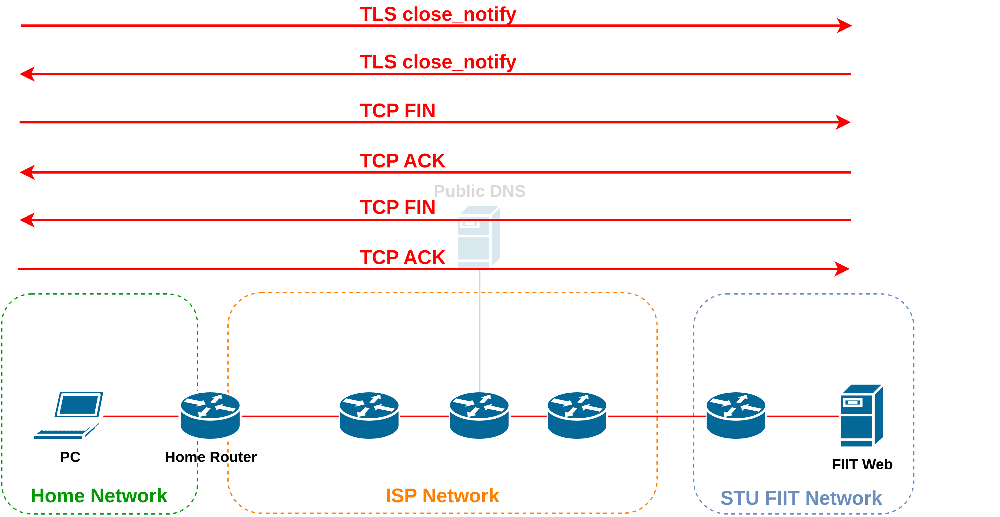

---

# Operating system view

Layers 1–2 are implemented on the Network Interface Card (NIC), in hardware.

Layers 3–4 are implemented in the operating system (OS), in software.

Layer 7 consists of the applications running on top of the OS, in software. TLS runs inside the application, as a library.


---

# Operating system view

<div class="text-sm">

Step 1: DHCP.
- Done in the operating system (OS). Application (browser) doesn't need to know.

Step 2: ARP.
- Also done in the OS.

Step 3: DNS lookup.
- Browser calls getaddrinfo to make the OS perform the lookup.

Step 4: Connect to website.
- Browser opens a TCP connection. OS implements TCP, e.g. splitting/reordering packets.
- Browser's TLS library runs the handshake and encrypts. The OS sees only encrypted bytes.
- Browser sends HTTP requests and receives HTTP responses over the secure bytestream.

*Note: With HTTP/3, the browser runs QUIC itself over a UDP socket, so the transport moves from the OS into the application.*

</div>

---

# References

<div class="text-sm">

1. KAO, Peyrin. CS 168 Textbook: Introduction to the Internet: Architecture and Protocols. [online]. University of California, Berkeley, 2024 [accessed 2025-09-03]. Available from: https://textbook.cs168.io/
2. KUROSE, James F. and ROSS, Keith W. Computer Networking: a Top Down Approach – authors' website. [online]. University of Massachusetts Amherst, 2025 [accessed 2025-09-03]. Available from: https://gaia.cs.umass.edu/kurose_ross/index.php
3. MOZILLA CONTRIBUTORS. HTTP messages. In: MDN Web Docs [online]. Mozilla Foundation [accessed 2026-10-26]. Available from: https://developer.mozilla.org/en-US/docs/Web/HTTP/Guides/Messages

<br>

## License
This presentation incorporates material from three sources:
- Portions adapted from **[Peyrin Kao / UC Berkeley]**, licensed under [CC BY-SA 4.0](https://creativecommons.org/licenses/by-sa/4.0/).
- Some slides and figures adapted from **J.F. Kurose and K.W. Ross**, *Computer Networking: A Top-Down Approach*. © 1993–2025 J.F. Kurose and K.W. Ross. All rights reserved. Used for educational purposes with attribution.
- HTTP message anatomy figure adapted from **Mozilla Contributors, MDN Web Docs**, licensed under [CC BY-SA 2.5](https://creativecommons.org/licenses/by-sa/2.5/).

Text and formatting were refined with AI assistance; all technical content was reviewed and verified by the author.

</div>
