# Computer and Communication Networks : IPv6
Lecture 6

---
layout: default
---

# Content overview

- Why IPv6
- IPv6 header
- IPv6 addresses
- ICMPv6 and NDP
- Address autoconfiguration
- How an IPv6 host routes
- IPv6 subnetting
- Coexistence and adoption
- IPv6 security

---
layout: section
---

# Why IPv6

IPv4 has 32-bit addresses, about 4.3 billion of them. In 2011, IANA handed its last free blocks to the regional registries, which ran out in the following years (RIPE NCC in 2019). The Internet kept growing anyway. IPv6 is the long-term answer.

---

# IPv4 issues

- Not enough public IPv4 addresses: 2^32 ≈ 4.3 × 10^9
- Increasing complexity of routing tables
- Global reachability lost: hosts behind NAT cannot be reached from outside
- NAT as a workaround, recall NAT from the network layer lecture
- IoT: billions of new devices, each needing an address

---

# What IPv6 changes

- Larger address space: 2^128 ≈ 3.4 × 10^38
- Hierarchical addressing, which lets routers aggregate routes
- No need for NAT: every device can have a public address
- Simpler packet processing: fixed 40-byte header, no header checksum
- Only the source fragments, routers never do
- No broadcast: multicast takes over its job
- Autoconfiguration: hosts can set up their own addresses

---
layout: section
---

# IPv6 header

---

# IPv4 vs. IPv6 header

<div class="grid grid-cols-2 gap-6 items-start">
  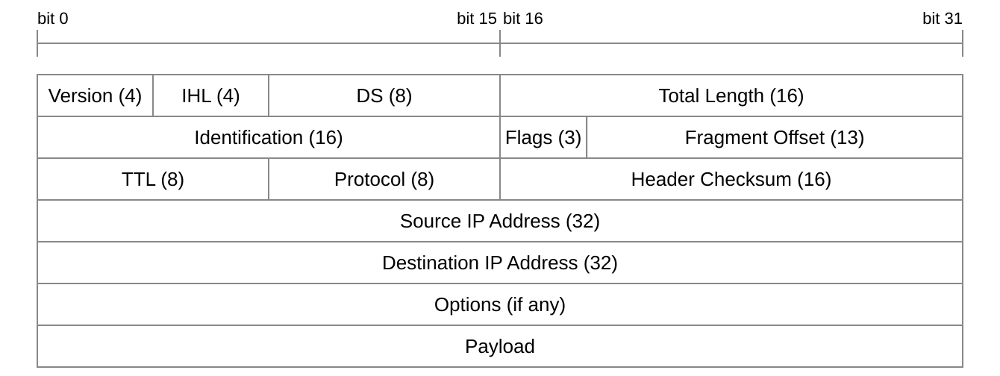
  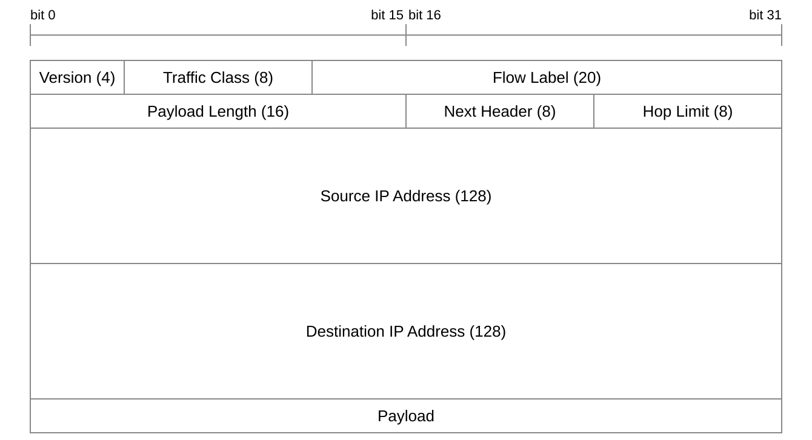
</div>

- **Kept:** Version, source and destination address (now 128 bits each)
- **Renamed:** DS -> Traffic Class, TTL -> Hop Limit, Protocol -> Next Header, Total Length -> Payload Length
- **Removed:** IHL, Identification, Flags, Fragment Offset, Header Checksum, Options
- **New:** Flow Label

The header is a fixed 40 bytes, twice the minimum IPv4 header: simpler, not shorter.

---
layout: three-slots
---

# IPv6 header fields

::left::
- Version: 6 (0b0110)
- Traffic Class: priority (QoS), the same role as the DS field in IPv4
- Flow Label: marks packets of one flow, so routers can treat them alike
- Payload Length: length of everything after the 40-byte header (Total Length in IPv4 included the header)
- Next Header: what follows, an extension header or the transport protocol (Protocol in IPv4)
- Hop Limit: decremented by every router, packet dropped at 0 (TTL in IPv4)

::right::


*Note: there is no header checksum. Ethernet FCS and the transport checksum already catch errors, and routers no longer recompute a checksum at every hop. That is also why the UDP checksum is mandatory in IPv6.*

---

# Extension headers

Anything optional moves out of the main header into **extension headers**, placed between the IPv6 header and the transport header.

- Each header's Next Header field says what comes next, forming a chain
- Without extension headers, Next Header points straight to TCP (6) or UDP (17), just like Protocol in IPv4
- Routers on the path process only the main 40-byte header (except Hop-by-Hop Options, and a Routing header addressed to that router)
- Examples: Hop-by-Hop Options (0), Routing (43), Fragment (44)

```
| IPv6 header      | Fragment header  | UDP header | Data |
| Next Header = 44 | Next Header = 17 |            |      |
```

---

# Fragmentation and MTU in IPv6

Recall from the transport lecture: an IPv4 router fragments a packet that does not fit the next link, unless DF = 1. An IPv6 router never does.

- A router that cannot forward a packet drops it and sends back ICMPv6 **Packet Too Big**
- So in IPv6, every packet behaves as if DF = 1, and Path MTU Discovery works the same way
- Only the source may fragment, using the Fragment extension header
- Every IPv6 link must carry packets of at least **1280 bytes**

This is where the ~1200-byte UDP advice from the transport lecture comes from: 1280 − 40 (IPv6 header) − 8 (UDP header) = **1232 bytes** of payload, the size DNS recommends.

---
layout: section
---

# IPv6 addresses

---

# IPv6 address format

- 128 bits = 16 bytes
- Written in hexadecimal as eight 16-bit groups, called **hextets**, separated by ":"
  - 2001:0db8:0000:1111:0000:0000:0000:0200

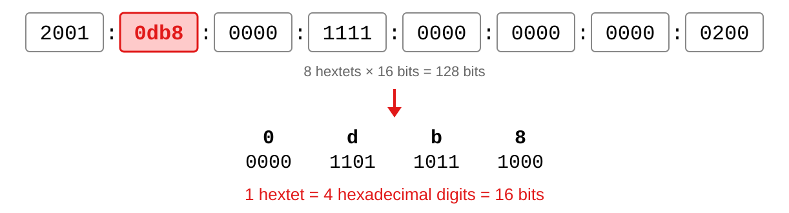

---

# IPv6 address: short notation

Two rules:
1. Omit leading zeros in each hextet
2. Replace one run of consecutive all-zero hextets with "::", only once per address

<div class="text-sm">

| Step | Address |
|---|---|
| Full | 2001:0db8:0000:1111:0000:0000:0000:0200 |
| Leading zeros omitted | 2001:db8:0:1111:0:0:0:200 |
| Zero run replaced | 2001:db8:0:1111::200 |

*Note: the recommended form (RFC 5952) uses lowercase letters, applies "::" to the longest run of zeros, and never to a single zero hextet.*

</div>

---

# IPv6 address: exercise

What is the short notation of this address?
- 2001:0db8:cafe:0000:0000:002e:0000:7334

<v-click>

Solution:
- 2001:db8:cafe:0:0:2e:0:7334 (leading zeros omitted)
- 2001:db8:cafe::2e:0:7334 (shortest form: "::" replaces the two zero hextets, the single 0 stays)
</v-click>

<v-click>

Is this notation correct?
- 2001:0db8:0000:00a3:abcd:0000:0000:1234
- 2001:db8::a3:abcd::1234
</v-click>

<v-click>

Solution:
- No. "::" may appear only once, otherwise nobody can tell how many zero hextets each one stands for
- Correct: 2001:db8:0:a3:abcd::1234
</v-click>

---

# Prefix and interface ID

Like IPv4, an IPv6 address has a network part and a host part. IPv6 drops the dotted subnet mask and uses only the prefix length.

- **Prefix:** the network part, written as /length, e.g. 2001:db8:acad:1::/64
- **Interface ID:** the host part, the rest of the 128 bits
- On a normal LAN the split is always /64: 64 bits of prefix, 64 bits of interface ID (more in IPv6 subnetting)

Same idea as the prefix length in the network layer lecture, just with 128 bits.

---

# IPv6 address types

- **Unicast:** one interface
- **Multicast:** a group of interfaces, every member gets a copy
- **Anycast:** the same address on several interfaces, the packet goes to the nearest one
- No broadcast: multicast to "all nodes" takes over its job

An IPv6 interface typically has several addresses at once (more in autoconfiguration).

---

# Unicast address types

<div class="text-sm">

| Type | Prefix | Scope | IPv4 counterpart |
|---|---|---|---|
| Global unicast (GUA) | 2000::/3 | Internet-routable, globally unique | Public address |
| Link-local (LLA) | fe80::/10 (in practice fe80::/64) | One link only, never routed | 169.254.0.0/16 |
| Unique local (ULA) | fc00::/7 (in practice fd00::/8) | Inside an organization | RFC 1918 private address |
| Loopback | ::1/128 | The host itself | 127.0.0.1 |
| Unspecified | ::/128 | "No address yet" | 0.0.0.0 |

Every IPv6 interface must have a link-local address.

*Note: 2001:db8::/32 is reserved for documentation, which is why every example in this lecture uses it (like 192.0.2.0/24 in IPv4).*

</div>

---

# Multicast addresses

All multicast addresses start with ff. The prefix ff02:: means "this link only".

<div class="text-sm">

| Address | Who listens |
|---|---|
| ff02::1 | All nodes on the link (replaces broadcast) |
| ff02::2 | All routers on the link |
| ff02::1:2 | All DHCPv6 servers and relays |
| ff02::1:ffXX:XXXX | Solicited-node: every node with an address ending in the same 24 bits (XX:XXXX) |

Example: 2001:db8::1078:90ab listens on the solicited-node address ff02::1:ff78:90ab.

On Ethernet, an IPv6 multicast address maps to the MAC address 33:33 followed by its last 32 bits, here 33:33:ff:78:90:ab (recall multicast from the link layer lecture).

</div>

---

# IPv6 address in practice

- In a URL, the address goes in square brackets, so its colons are not mistaken for a port
  - https://[2001:db8:a3:abcd::1234]:8080/
- A link-local address needs a **zone ID**: the same fe80:: prefix exists on every link, so the host must say which interface to use
  - fe80::1%eth0 (Linux), fe80::1%12 (Windows)

---
layout: section
---

# ICMPv6 and NDP

---

# ICMPv6: more than ping

IPv4 has ICMP for error and control messages. IPv6 has ICMPv6 (Next Header = 58), and depends on it far more.

- **Echo Request / Reply:** ping (recall RTT from the link layer lecture)
- **Time Exceeded:** Hop Limit reached 0, used by traceroute
- **Packet Too Big:** the router's answer when a packet does not fit
- **Neighbor Discovery:** all five NDP messages are ICMPv6

In IPv4, blocking ICMP causes trouble (for example with Path MTU Discovery). In IPv6, blocking all ICMPv6 breaks IPv6 entirely.

---

# NDP: five messages

Neighbor Discovery Protocol (NDP) does in IPv6 what ARP, ICMP Router Discovery and ICMP Redirect do in IPv4.

- **Router Solicitation (RS):** a host asks routers to announce themselves
- **Router Advertisement (RA):** a router announces the prefix, its own address and configuration flags
- **Neighbor Solicitation (NS):** "who has this IPv6 address?", also used for duplicate address detection
- **Neighbor Advertisement (NA):** the answer, with the MAC address
- **Redirect:** a router tells a host about a better first hop

RS and RA drive autoconfiguration. NS and NA handle address resolution and duplicate address detection.

---
layout: three-slots
---

# NDP: address resolution

::left::
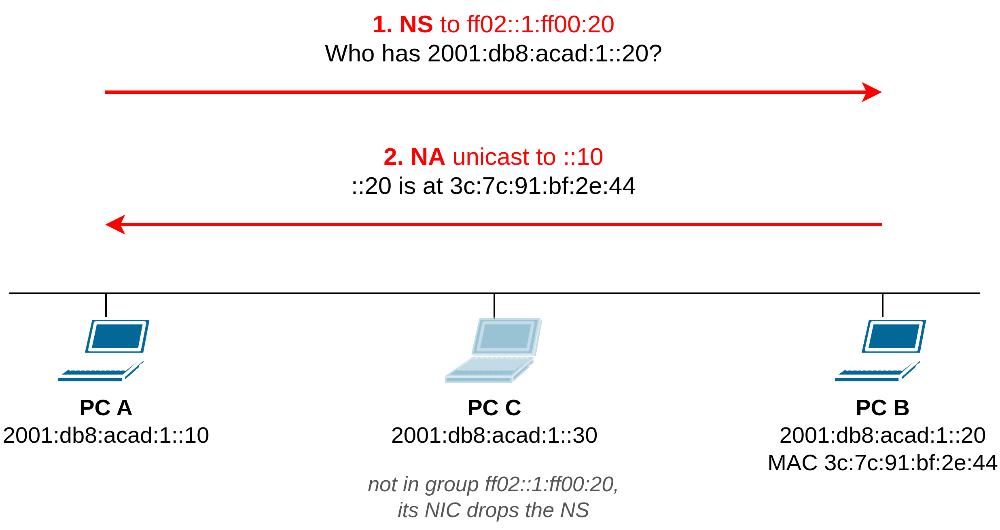

::right::
<div class="text-sm">

| | ARP (IPv4) | NDP (IPv6) |
|---|---|---|
| Question | ARP request, broadcast to FF:FF:FF:FF:FF:FF | Neighbor Solicitation, solicited-node multicast |
| Answer | ARP reply, unicast | Neighbor Advertisement, unicast |
| Runs over | Directly over Ethernet (EtherType 0x0806) | ICMPv6 inside IPv6 (EtherType 0x86DD) |
| Cache | ARP cache | Neighbor cache (`ip -6 neigh`) |

</div>

---

# NDP: router discovery

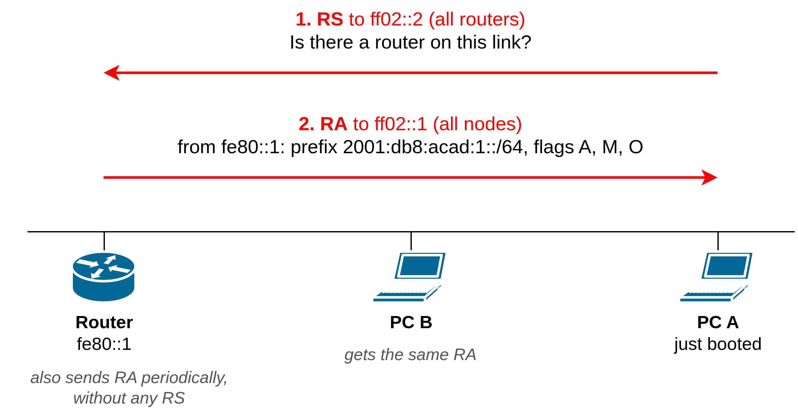

The RA carries the link's prefix, the router's link-local address (the default gateway) and flags that tell hosts how to configure themselves.

---

# NDP: duplicate address detection

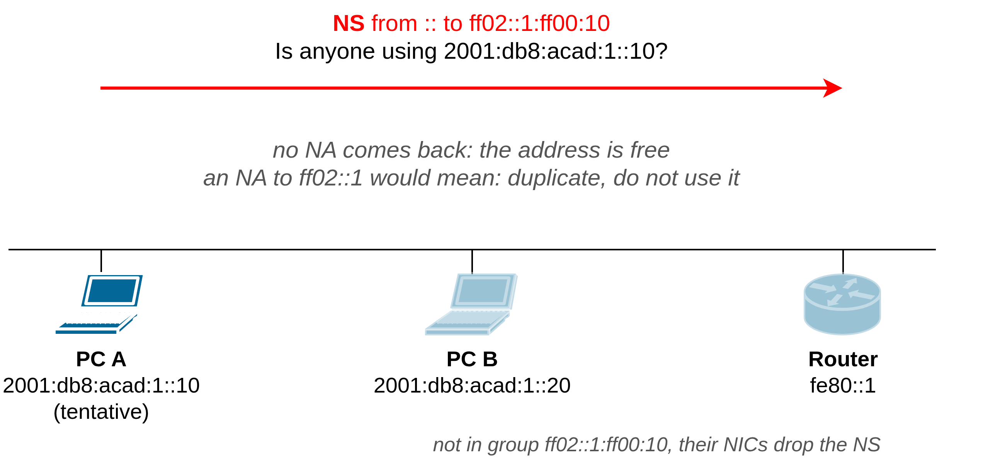

Before using a new address, the host sends an NS for it from the unspecified address ::. No answer means the address is free.

Until DAD finishes, the address is *tentative*: the host may not use it as a source.

---
layout: section
---

# Address autoconfiguration

---

# Why autoconfiguration

- One interface has several IPv6 addresses, so configuring them by hand is not practical
- Every IPv6 host configures its link-local address by itself, with or without a router
- For a global address, the router's RA tells the host which method to use
- **SLAAC** (Stateless Address Autoconfiguration): the host takes the /64 prefix from RA and adds its own interface ID. No server keeps track of the addresses, which is why it is called stateless.

---
layout: three-slots
---

# Interface ID: EUI-64 or random

::left::
- **Modified EUI-64:** derived from the MAC address. Split it, insert fffe in the middle, flip the 7th bit (U/L)
- **Random:** the default in most current operating systems
  - Stable per network (RFC 7217)
  - Temporary, changing regularly, for outgoing connections (RFC 8981)
- Why random: an EUI-64 address carries the MAC, so the same device can be tracked from network to network

::right::
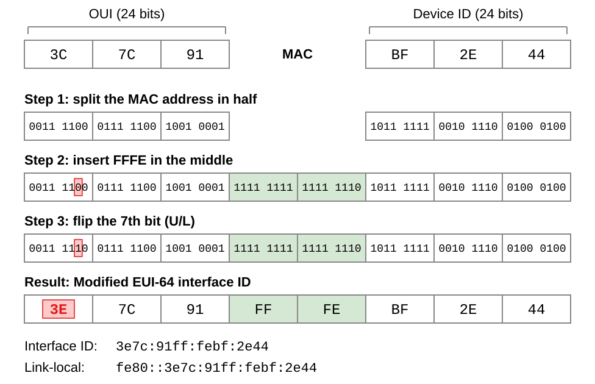

---

# Link-local address

Every IPv6 interface builds one as soon as it comes up, with no router and no server:
- Prefix fe80::/64
- Interface ID: random or Modified EUI-64
- Duplicate address detection (NDP) before use

---

# Global address: three options

The router's RA tells hosts which method to use: the A (autonomous) flag in the prefix option allows SLAAC, the M (managed) and O (other configuration) flags point to DHCPv6.

<div class="text-sm">

| Method | RA flags | Address from | DNS and other settings | Default gateway |
|---|---|---|---|---|
| SLAAC | A = 1, M = 0, O = 0 | SLAAC (prefix from RA) | RA | RA |
| SLAAC + stateless DHCPv6 | A = 1, M = 0, O = 1 | SLAAC | DHCPv6 | RA |
| Stateful DHCPv6 | A = 0, M = 1 | DHCPv6 server | DHCPv6 | RA |

</div>

The default gateway always comes from RA: it is the router's link-local address. Every new address goes through duplicate address detection.

*Note: with A = 1 and M = 1, the host gets both a SLAAC and a DHCPv6 address.*

---

# Global address: the messages

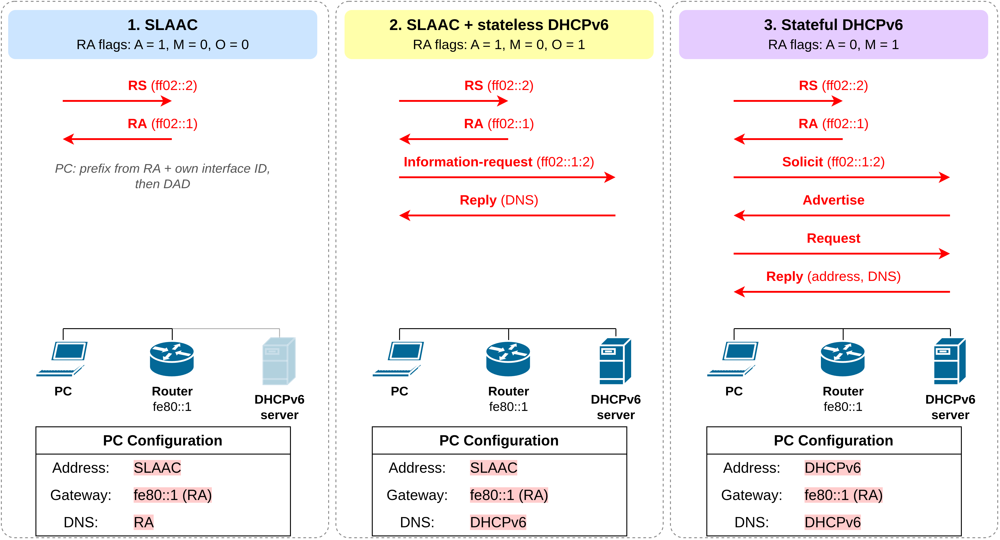

---

# Stateful DHCPv6

A DHCPv6 server hands out addresses and keeps track of them, so it holds state.

1. **Solicit:** the client multicasts to ff02::1:2 (all DHCPv6 servers)
2. **Advertise:** a server offers an address
3. **Request:** the client asks for the offered address
4. **Reply:** the server confirms

Unlike DHCP in IPv4, DHCPv6 sends neither the default gateway nor the prefix length. Both still come from RA.

---

# One interface, many addresses

A typical laptop on an IPv6 network (`ip -6 addr` on Linux, shortened):

```
2: wlan0: <BROADCAST,MULTICAST,UP,LOWER_UP> mtu 1500
    inet6 2001:db8:acad:1:9c3f:41e2:7a10:5b6d/64 scope global temporary dynamic
    inet6 2001:db8:acad:1:5e2a:8f01:c4d7:2b93/64 scope global dynamic mngtmpaddr
    inet6 fe80::8d2a:61c4:e93b:7f05/64 scope link
```

- **Temporary global:** changes regularly, used for outgoing connections, for privacy
- **Stable global:** stays the same in this network, used for incoming connections
- **Link-local:** always there, used for NDP and to reach the router

---
layout: section
---

# How an IPv6 host routes

---

# Host forwarding decision in IPv6

In the network layer lecture, an IPv4 host compared network addresses using its subnet mask. IPv6 follows the same idea, with NDP in place of ARP.

- **Local or remote?** The destination is local if it matches a prefix the router announced as on-link in RA (usually the /64)
- **Local:** find the destination's MAC with NS/NA and send directly
- **Remote:** send to the default router, using its link-local address from RA, e.g. `default via fe80::1 dev eth0`

As in IPv4, the destination IP stays unchanged, but the destination MAC becomes the router's MAC.

---
layout: section
---

# IPv6 Subnetting

---

# Why every LAN gets a /64

- Trivial compared to IPv4: no host counting, no VLSM
- Every LAN gets a /64, because SLAAC needs a 64-bit interface ID

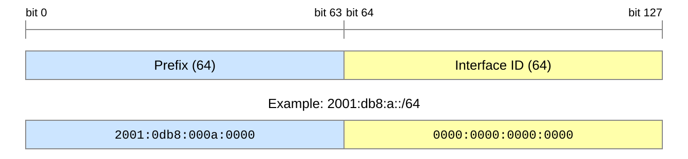

---

# GUA structure

- Global routing prefix (48 bits): assigned to the site by its ISP
- Subnet ID (16 bits): chosen by the site's administrator
- Interface ID (64 bits)

*Note: ISPs often give households a /56, which leaves 8 bits for subnets.*

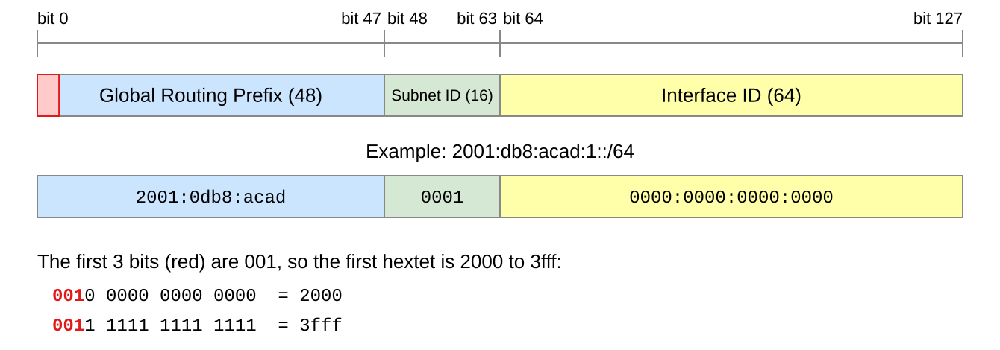

---

# Subnetting example

Site prefix 2001:db8:acad::/48. Each network simply gets the next Subnet ID: 2001:db8:acad:1::/64, 2001:db8:acad:2::/64, and so on.

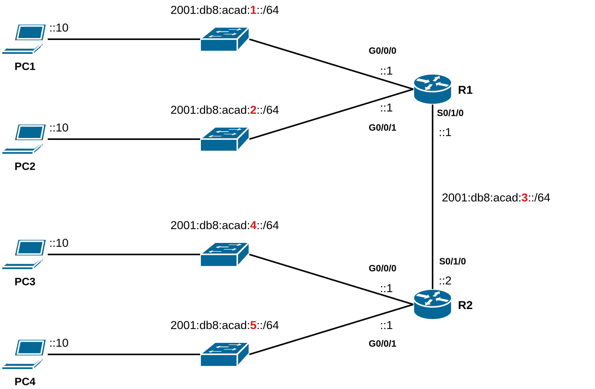

A /48 holds 2^16 = 65 536 subnets of size /64. Compare with the VLSM example in the network layer lecture, where every bit had to be counted.

---

# Subnetting with link-local addresses only?

Is subnetting using only LLA possible?


---
layout: section
---

# Coexistence and adoption

---

# Transition mechanisms

- **Dual stack:** a device runs IPv4 and IPv6 at the same time. The most common approach today.
- **Tunneling:** IPv6 packets travel as payload inside IPv4 packets across an IPv4-only network.
- **Translation (NAT64):** a gateway translates between IPv6 and IPv4 headers, so an IPv6-only client can reach an IPv4-only server. Usually paired with DNS64.

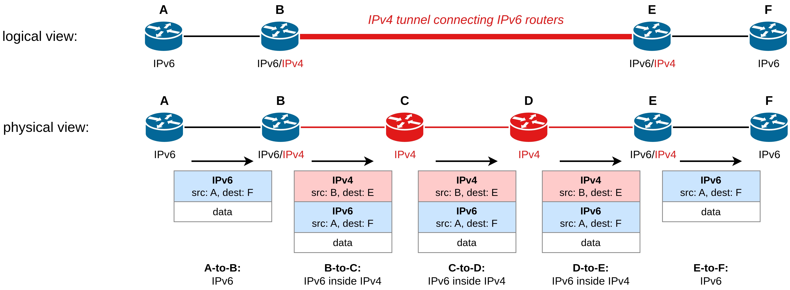

---

# IPv6 adoption

- In March 2026, Google measured over 50% of its users reaching it over IPv6 for the first time
- Adoption varies widely by country and network, mobile networks are often IPv6-first
- It took over 25 years: IPv6 was first specified in 1995 (RFC 1883), revised in 1998 (RFC 2460), and is now RFC 8200

Why so slow? NAT made the address shortage bearable, and IPv6 brings no new feature that users would notice.

<div class="grid grid-cols-2 gap-4 items-center">
  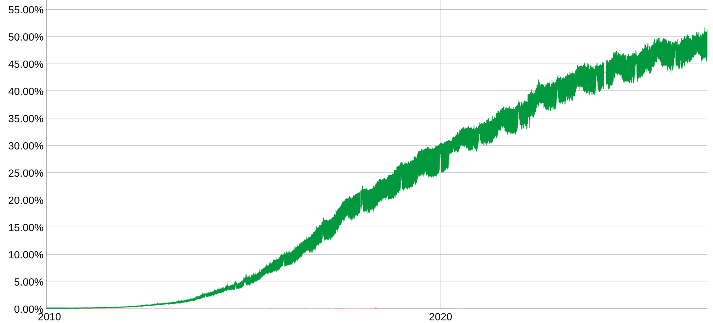
  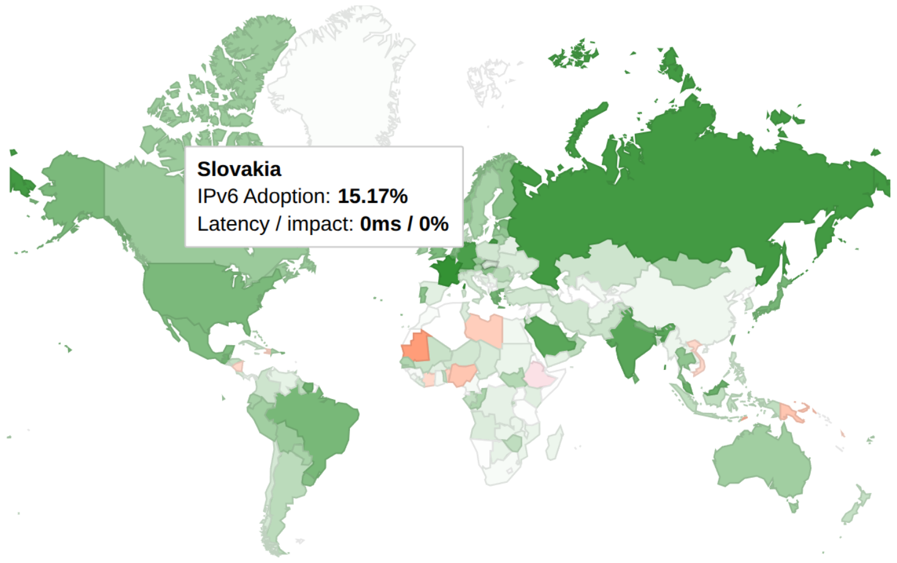
</div>

<div class="text-xs text-center opacity-70">Source: Google IPv6 statistics, google.com/ipv6, accessed 28 Oct 2026</div>

---

# IPv6 security

- No NAT means every host has a public address: a stateful firewall has to block unwanted inbound traffic. NAT's security benefit from the network layer lecture was only a side effect.
- Dual stack with no IPv6 firewall rules: a forgotten open door
- NDP has no authentication, the same problem as ARP spoofing: a fake RA can make hosts send all traffic to an attacker
- First-hop protection on switches: RA Guard, ND Inspection / IPv6 Snooping
- SEND (RFC 3971) signs NDP messages, but it was never widely deployed

---

# IPv6: summary

- 128-bit addresses, written in hex, shortened with the leading-zero and "::" rules
- Fixed 40-byte header, optional features in extension headers, only the source fragments
- No broadcast: multicast, and NDP over ICMPv6 instead of ARP
- Hosts configure themselves: link-local always, global via SLAAC or DHCPv6, gateway always from RA
- Every LAN is a /64, subnetting means counting Subnet IDs
- IPv4 and IPv6 coexist: dual stack, tunneling, NAT64

---

# References

<div class="text-xs">

1. Cisco Networking Academy. CCNA: Introduction to Networks.
2. KUROSE, James F. and ROSS, Keith W. Computer Networking: a Top Down Approach – authors' website. [online]. University of Massachusetts Amherst, 2025 [accessed 2025-09-03]. Available from: https://gaia.cs.umass.edu/kurose_ross/index.php
3. KAO, Peyrin. CS 168 Textbook: Introduction to the Internet: Architecture and Protocols. [online]. University of California, Berkeley, 2024 [accessed 2025-09-03]. Available from: https://textbook.cs168.io/
4. RFC 8200 (IPv6 specification), RFC 4291 (addressing architecture), RFC 5952 (text representation), RFC 4443 (ICMPv6), RFC 4861 (Neighbor Discovery), RFC 4862 (SLAAC), RFC 7217 and RFC 8981 (interface identifiers), RFC 8415 (DHCPv6), RFC 3971 (SEND)
5. Google. IPv6 statistics. [online]. [accessed 2026-10-28]. Available from: https://www.google.com/intl/en/ipv6/statistics.html

## License
This presentation incorporates material from four sources:
- Portions adapted from **[Peyrin Kao / UC Berkeley]**, licensed under [CC BY-SA 4.0](https://creativecommons.org/licenses/by-sa/4.0/).
- Some slides and figures adapted from **J.F. Kurose and K.W. Ross**,  *Computer Networking: A Top-Down Approach*. © 2010–2025 J.F. Kurose and K.W. Ross. All rights reserved. Used for educational purposes with attribution.
- Some content adapted from **Cisco Networking Academy**, *CCNA: Introduction to Networks*. Used for educational purposes with attribution.
- IPv6 adoption charts from **Google IPv6 statistics**. Used for educational purposes with attribution.

Text and formatting were refined with AI assistance; all technical content was reviewed and verified by the author.

</div>
